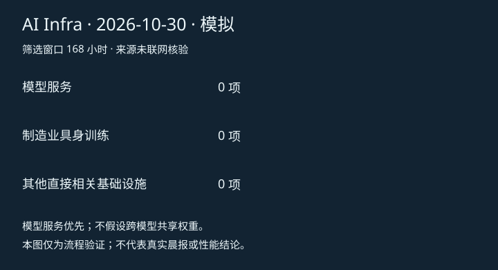

# AI Infra 晨报 · 2026-10-30（模拟）

> 模拟干跑：未联网、未调用模型、未核验来源，不可作为真实晨报发送。

截至：2026-10-30T08:00:00+08:00；时区：Asia/Shanghai；最终筛选窗口：168 小时。

## 零项结果
本次模拟输入没有合格新项。未做真实检索，不能据此判断今天没有新闻。

## 运行说明
- 本地零项 fixture；未进行真实检索，不能据此判断今天没有新闻。
- 实际 adapter：本地 fixture 研究 + 确定性编辑；两阶段 prompt 未被模型执行。
- 已读取 0 份历史报告；URL/事件键去重已执行，语义去重尚未接入模型。
- 未达到目标数量时保留不足或零项，不使用过期条目补位。

真实网络研究、模型研究/编辑、Slack 图文投递均待接入。本地模拟回执不代表真实送达。
