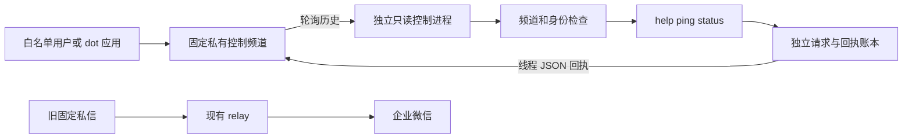
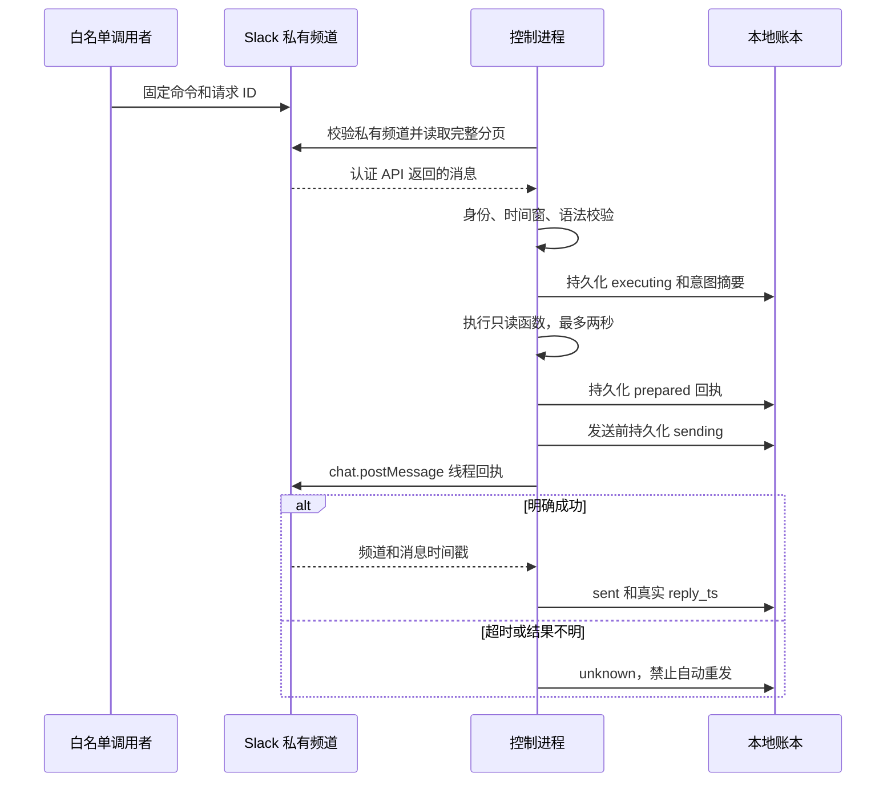

# Slack 私有频道只读控制

独立 Linux 单线程进程 `ai-brief-control` 轮询一个固定私有频道，在原请求线程返回 JSON 回执。只执行 `help`、`ping`、`status`。没有任意 shell、代码、抓取、发布、重发、部署或启停指令，也不调用旧 relay 的本地控制接口。

默认未启用。完整 `sfcloud-ai` wheel 包含入口，现有 CD 的 `sfcloud-ai-relay` 专用 wheel 不包含本模块。代码安装不等于服务启动、Slack App 授权或真实双向联调。

## 协议与身份

在配置的控制频道发新的顶层纯文本消息：

```text
!ai-brief probe-001 help
!ai-brief probe-002 ping
!ai-brief probe-003 status
```

严格要求三个字段、单个空格、小写命令且无额外参数。`request_id` 为 1–64 位 ASCII 字母、数字、下划线或连字符，首位为字母或数字。新操作使用新 ID，同一请求重试沿用原 ID。普通聊天忽略，以 `!ai-brief` 开头的错误格式和未知命令返回拒绝回执，不回显原文。

```json
{"type":"ai_brief_control_receipt","v":1,"request_id":"probe-002","source_ts":"1800000001.000000","command":"ping","status":"ok","code":"ok","result":{"pong":true}}
```

- `help` 返回固定命令、语法和请求有效期。
- `ping` 返回 `pong`，用于确认本次控制请求已处理。
- `status` 返回本控制进程的存活状态和运行时长，明确标记 `relay_health=not_checked`、`brief_pipeline=not_connected`。不读取生产 relay、凭据、路径、主机信息或日报状态。
- `allowed_users` 使用实际 Slack 用户 ID，匹配没有 bot 标记的人类消息。
- `allowed_bots` 每项为 `{"app_id":"实际应用 ID","bot_id":"实际安装 bot ID"}`，同时匹配两个字段，兼容没有 `user` 字段的 bot 消息。dot 若以 bot 身份发布，应配置其实际安装身份，不能把 dot 和回执 bot 当作同一个身份。若 dot 以用户身份发送，只按实际 Slack 用户白名单处理，服务不能证明消息背后是哪位人类或哪个工具。
- `responder_user_id` 和 `responder_bot_id` 必须与本服务 bot token 的 `auth.test` 一致，不能加入调用者白名单。自身消息、线程回复、编辑、隐藏消息、非允许 subtype、其他频道／工作区及未知身份全部忽略。
- 授权的应用身份代表该应用的全部发送能力，并不自动继承应用操作者的个人权限。未核实 dot 实际字段、私有频道可见性及读写能力前，保持 `allowed_bots=[]`，不能宣称 dot 已接通。

## 架构



仅复用旧模块的安全文件读取、单实例锁及禁止代理／重定向的 HTTP opener，不修改旧 relay 代码、配置、游标或投递账本。控制进程不持有企微 webhook，不读取日报频道。新 SQLite 文件只保存控制传输元数据，不是 Roadmap #2 所取消的晨报历史数据库。



## 去重、超时与恢复边界

首次运行以当前时间建立基线，不执行既有历史。重启保留游标，只接受 Slack 原始时间戳在过去 300 秒内的消息，未来消息拒绝。服务时钟需正确同步。断线后在这个窗口内补读，超过窗口的请求不执行；停机超过五分钟可能丢弃请求，调用者应使用新 ID 发起新的只读查询。

每个请求同时由源消息时间戳和全局请求 ID 去重。相同 ID、相同身份及原文不执行、不重复回帖；相同 ID 的不同意图返回 `request_id_conflict`，该拒绝回执使用 `conflict:` 开头的源事件 ID，不覆盖旧结果。不支持查询任意旧请求或重发回执，旧结果可在原 Slack 线程查看。

计算前持久化 `executing`，计算后保存 `prepared`；重启时 `executing` 转为 `interrupted` 回执，绝不重新执行。未发送的 `prepared` 只在原有效期内尝试一次。发送前落盘 `sending`，成功必须取得固定频道及有效 Slack 消息时间戳才记录 `sent`。`sending` 重启或网络异常转为 `unknown`，不自动重发。HTTP 429 记作明确失败并按 `Retry-After` 暂停后续请求，该回执不重试。过期未发送回执记作 `expired`。因此本实现提供保守的至多一次发送尝试，不承诺恰好一次送达。

固定函数硬超时 2 秒，Slack 每次 HTTP 调用硬超时 15 秒，单页最多 15 条，单次最多 10 页。全部分页读取成功后才执行，失败保留原游标。默认轮询间隔 60 秒，回执间隔至少 1.1 秒。低速率 Slack 安装、多页积压或服务中断可能使请求过期；这不是实时控制通道。当前不清理账本，以免重新开放已使用的请求 ID，需由后续维护方案处理容量。

账本绑定工作区、频道、回执身份及调用者白名单；更改后拒绝启动，避免旧请求带入新身份范围。需要改变这些配置时先停服务，审查旧回执及迁移方案，不删除账本或自行重置游标。仅调整轮询间隔无需迁移。单实例锁覆盖恢复、轮询和发送全过程，损坏／权限不安全的状态阻止启动。

## 待授权的 Slack 配置

本实现需要专用 bot token，最小 OAuth scopes 为：

| Scope | 用途 |
| --- | --- |
| `groups:read` | `conversations.info` 验证私有频道、成员资格、非共享及未归档状态 |
| `groups:history` | `conversations.history` 读取已加入私有频道的顶层请求 |
| `chat:write` | 在固定控制频道的原请求线程写回执 |

无需 `chat:write.public`、用户令牌、文件权限、部署权限、事件订阅、公开 webhook 或 Socket Mode。具有权限不代表已加入私有频道，须另行获准将服务 bot 加入目标控制频道。官方依据：[history](https://docs.slack.dev/reference/methods/conversations.history/)、[info](https://docs.slack.dev/reference/methods/conversations.info/)、[postMessage](https://docs.slack.dev/reference/methods/chat.postMessage/)。轮询速率受 Slack 安装类型和服务端限流影响，不能以本地模拟代替配额验证。

dot 自身能否发送上述文本、保留请求 ID、读取线程回执，以及其所需权限，由 dot 的实际连接方式决定，不由本服务授予。本模块不创建 token、不邀请成员、不修改权限，也不接管日推频道。

## 后续获准后的运行配置

使用独立系统用户及独立绝对根目录，不能复用生产 relay 根目录。根目录与 `state/`、`run/`、`secrets/` 为该运行用户所有且权限 `0700`；`config.json` 与 `secrets/bot.json` 为 `0600` 常规文件，不允许符号链接或硬链接。不要把运行根目录放在 Git 仓库内。

从 `config.example.json` 填入核实的工作区、控制频道及真实身份，空模板不能启动。`secrets/bot.json` 仅含 `slack_bot_token`，凭据通过独立秘密配置流程提供，不能放进命令行、聊天、日志或 PR。不要把旧 relay 的 `credentials.json` 复制给控制进程。

安装完整 wheel 后，`ai-brief-control capabilities` 可离线检查打包。获准配置后可用 `ai-brief-control preflight --root /absolute/control-root` 验证身份与频道；它不创建账本、不设基线、不发送消息。`ai-brief-control serve --root /absolute/control-root` 才开始控制轮询。此 PR 不添加 systemd 单元、不接 CD、不运行这些联网命令，也不改变现有生产服务。

离线验证入口为 `python -m unittest discover -s tests -v`，覆盖模拟 Slack 响应、身份拒绝、回执参数、超时、分页、去重、故障恢复、安装入口和旧链路回归。真实私有频道的双向验收须在单独授权后进行。
